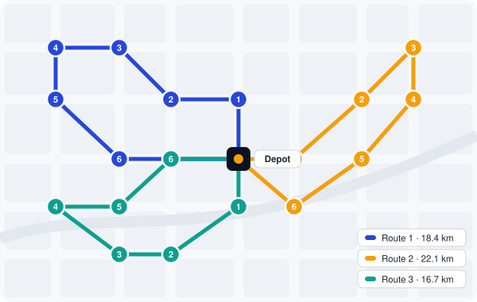
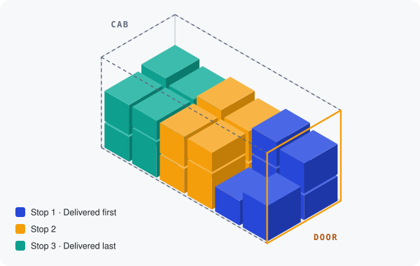
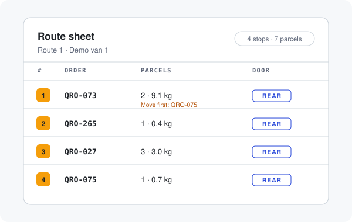
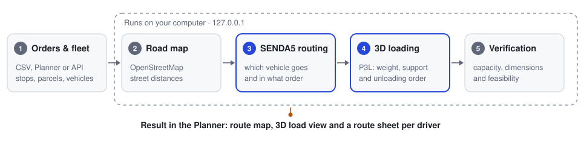
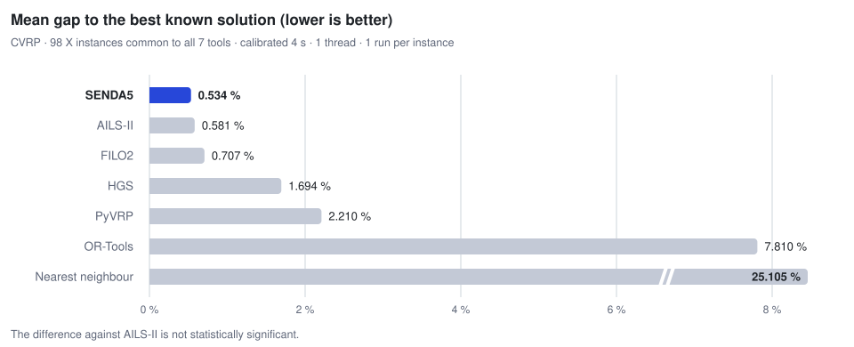

<div align="center">


### Routes and load planning in one plan, computed on your own machine

Decide which vehicle serves each delivery, the order of its stops<br>
and how to place the boxes so each one comes out without moving the rest.

[](docs/en/CHANGELOG.md)
[](docs/en/SENDA5.md)
[](https://github.com/Erick-MF28/lattimex/actions/workflows/ci.yml)
[](LICENSE)
[](pyproject.toml)
[](native/)

[**Try it in 10 minutes**](#try-it-in-10-minutes) · [How it works](#how-it-works) · [SENDA5 results](#senda5-the-routing-core) · [Implementation](#implementation-for-your-fleet) · [Español](README.md)

</div>

<br>

<p align="center"></p>

<p align="center"><sub>Example bundled with the Planner: 300 synthetic deliveries and six vans in Querétaro, Mexico, optimized with engine 1.9.0 (466 km, verified loading). Map © <a href="https://www.openstreetmap.org/copyright">OpenStreetMap contributors</a>.</sub></p>

## Who it is for

<table>
<tr>
<td width="32%">🚚 &nbsp;<b>Fleet planners</b></td>
<td>Build the day's routes without spreadsheets. See on the map where each vehicle goes and, in 3D, how its load is arranged.</td>
</tr>
<tr>
<td width="32%">📦 &nbsp;<b>Delivery owners and managers</b></td>
<td>Compare distance, cost and vehicles needed before dispatch. Operational data never leaves your computer.</td>
</tr>
<tr>
<td width="32%">🧑‍💻 &nbsp;<b>Developers and researchers</b></td>
<td>Get an MIT engine with C++ cores, a local API, reproducible tests and audited measurements against reference solvers.</td>
</tr>
</table>

## What it solves on a delivery day

<table>
<tr>
<td width="33%" valign="top">
<picture>
<source media="(prefers-color-scheme: dark)" srcset="docs/img/readme/ilus-rutas-oscuro-en.svg">

</picture>
<p><b>1 · Who goes where</b><br>
Assigns deliveries to vehicles and orders the stops on real streets. Each route shows its stops, distance and cost.</p>
</td>
<td width="33%" valign="top">
<picture>
<source media="(prefers-color-scheme: dark)" srcset="docs/img/readme/ilus-carga-oscuro-en.svg">

</picture>
<p><b>2 · How the load fits</b><br>
Places each box by dimensions, weight and support. What is delivered first sits by the door.</p>
</td>
<td width="33%" valign="top">
<picture>
<source media="(prefers-color-scheme: dark)" srcset="docs/img/readme/ilus-hoja-oscuro-en.svg">

</picture>
<p><b>3 · What the driver gets</b><br>
A route sheet with the stops in order, the packages for each delivery and the unloading instructions.</p>
</td>
</tr>
</table>

## Try it in 10 minutes

**Requirements:** Python 3.10 or later and a C++ compiler. If you need a compiler, install one with `python -m pip install ziglang`. On Windows, clone into a short path such as `C:\lattimex`.

**1. Get the code and install the dependencies**

```bash
git clone https://github.com/Erick-MF28/lattimex.git
cd lattimex
python -m pip install -r requirements.txt
```

**2. Build the engine.** This compiles the native routing and loading libraries.

```bash
python -m lattimex build
```

**3. Build the road map.** The example downloads Querétaro from OpenStreetMap. For another city, change the `south,west,north,east` box and the name.

```bash
python -m lattimex map --bbox 20.47,-100.52,20.82,-100.22 --name queretaro
```

**4. Start the local server and open the Planner**

```bash
python -m lattimex serve
```

Leave the server running and open **[lattimex.com/planner](https://lattimex.com/planner)**. Allow access to the local device if your browser asks. The Planner works with the server on your computer at `127.0.0.1`.

**5. Optimize the example.** Under **Guías** (orders), choose **Cargar ejemplo** (load example). Under **Planificación** (planning), choose **Optimizar** (optimize). When the plan is ready, select a van to inspect its stops and load.

<p align="center"></p>
<p align="center"><sub>Results for demo van 1: all 61 deliveries are unloaded without moving other boxes. The Planner interface is in Spanish.</sub></p>

> [!TIP]
> Check the installation with `python -m lattimex doctor`. To work without a terminal, run `python -m lattimex app`: it starts the server and opens the Planner from a window. To keep each operation's data apart, start with `python -m lattimex serve --data D:\operations\client_a`. On Windows, see [packaging](packaging/windows/README.md).

## How it works

<picture>
  <source media="(prefers-color-scheme: dark)" srcset="docs/img/readme/flujo-oscuro-en.svg">
  
</picture>

The local server only listens on `127.0.0.1` and requires a session token. Orders, fleet records and plans stay on your computer ([security](docs/en/SECURITY.md)). The engine solves routing and loading together. If a route's boxes do not fit while keeping the unloading order, the plan warns you and flags that route.

| Component | What it does | Where |
|---|---|---|
| **SENDA5** | Capacitated vehicle routing (CVRP). Below 125 nodes it runs SENDA2. | [`native/senda5_core.cpp`](native/senda5_core.cpp) |
| **P3L** | 3D loading with weight, support, fragility and unloading order per door. | [`native/p3l.cpp`](native/p3l.cpp) |
| **Engine** | Combines routing, loading and verification. Below six destinations per vehicle it uses SENDA 1.0. | [`lattimex/engine/`](lattimex/engine/) |
| **Server and maps** | Local API, SQLite database and a road network built from OpenStreetMap. | [`lattimex/server.py`](lattimex/server.py) · [maps](docs/en/MAPS.md) |

More in [Architecture](docs/en/ARCHITECTURE.md) and [Planner](docs/en/PLANNER.md).

## SENDA5: the routing core

Release 1.3.0 integrates SENDA5 into engine `lattimex-engine-1.9.0`. We compared it with six tools on 100 CVRPLIB X instances, from 100 to 1,000 customers, under the same clock.

<picture>
  <source media="(prefers-color-scheme: dark)" srcset="docs/img/readme/senda5-brecha-oscuro-en.svg">
  
</picture>

- **SENDA5 solved all 100 instances** with a mean gap of **0.549%**. The 0.534% in the chart covers the 98 instances solved by all seven tools.
- The advantage over FILO2, HGS, PyVRP and OR-Tools is statistically significant (bootstrap 95% CI). **Against AILS-II it is not:** SENDA5 had a lower gap on 54 instances, tied on 3 and trailed on 43.
- **Limitations:** one run per instance, one thread, unrestricted fleet and a calibrated 4 s budget. The algorithm was developed on these same instances. The results do not show improvements with time windows, fixed fleets or 3D loading.

📊 [Full results, measured times and limitations](docs/en/SENDA5.md) · [Audit summary (JSON)](docs/senda5_auditoria.json) · [Changelog](docs/en/CHANGELOG.md)

## Use it your way

| If you want to… | Use | More |
|---|---|---|
| Plan daily operations with a map and 3D view | The **Planner** with the local server | [Planner](docs/en/PLANNER.md) |
| Connect your ERP, WMS or TMS | The **local API**: send orders and fleet, get routes and loads back | [Local API](docs/en/API_LOCAL.md) |
| Solve routing alone for a CVRPLIB file | `python -m lattimex cvrp instance.vrp --time 4` | [Protocol](docs/en/SENDA5.md#integration) |
| Pack the boxes of a single route | `python -m lattimex pack boxes.json` | [Architecture](docs/en/ARCHITECTURE.md) |
| Generate synthetic deliveries for testing | `python -m lattimex sample --n 300` | |

<details>
<summary><b>Example local API request</b></summary>
<br>

`POST /api/engine/v1/solve` creates an optimization job. Point 0 is the depot. The response includes each route's sequence, the position of every box and the unloading plan.

```json
{
  "points": [{"lat": 20.5888, "lng": -100.3899}, {"lat": 20.5879, "lng": -100.3819}],
  "fleet": [{"cargo_cm": [365, 139, 165], "max_weight_kg": 1900, "doors": ["rear"]}],
  "fleet_count": 1,
  "packages": [{"id": "QRO-181", "node": 1, "dims_cm": [45, 35, 25], "weight_kg": 6.2}],
  "constraints": {"support": true, "fragility": false, "lifo": false},
  "budget_sec": 10
}
```

Every `/api/*` route requires the session token returned by `GET /api/runtime`. See the [full reference](docs/en/API_LOCAL.md).

</details>

## Implementation for your fleet

| Question | Answer |
|---|---|
| **Where is our data stored?** | On the customer's computer. The server only accepts local connections and checks the origin and token of every request. [Security](docs/en/SECURITY.md) |
| **Can it work with our existing system?** | A pilot can start with a CSV export from your ERP, WMS or TMS. Automated connections use the [local API](docs/en/API_LOCAL.md). We check field mappings against a sample file. |
| **Can it connect to our GPS platform?** | To send stops to a GPS platform, we review its formats and permissions. Live tracking is assessed with the provider. |
| **How do we get a quote?** | The engine is MIT-licensed and free. To estimate installation, integration and training, tell us your depots, vehicles, deliveries on a typical day and the systems you want to connect. |

<p align="center">
<a href="mailto:contacto@lattimex.com"><b>✉ contacto@lattimex.com</b></a> &nbsp;·&nbsp; <a href="https://lattimex.com"><b>lattimex.com</b></a>
</p>

## Development and research

```bash
python -m unittest discover -s tests/engine                                    # full engine
python -m unittest tests.test_senda3 tests.test_senda5 tests.test_local_api -v  # cores and API
python tests/native/test_pack3d_equivalencia.py                                # 3D loading
python -m lattimex probe                                                       # deterministic fingerprint
```

- **Methods and references:** [academic notes](docs/en/ACADEMIC_NOTES.md) and educational guides to [SENDA](paper/senda_guide_en.pdf), [SENDA2](paper/senda2_guide_en.pdf) and [SENDA3](paper/guia_senda3.pdf) (in Spanish).
- **Code:** [native cores](native/) · [engine](lattimex/engine/) · [server](lattimex/server.py) · [tests](tests/) · [code provenance](docs/en/AUTHORSHIP.md).
- **Cite:** use [CITATION.cff](CITATION.cff) or GitHub's *Cite this repository* button.

## Licenses

| Component | License |
|---|---|
| Engine, local server and map builder | [MIT](LICENSE). Use, modify and distribute them, including commercially, keeping the notices. |
| LATTIMEX Planner (lattimex.com/planner) | Free to use. Not distributed in this repository. Third parties may not redistribute or commercially exploit it. [License](https://lattimex.com/planner/licencia.html) |
| Educational guides (`paper/`) | [CC BY 4.0](https://creativecommons.org/licenses/by/4.0/). Cite the source and indicate changes. |
| Street data | © OpenStreetMap contributors, [ODbL 1.0](https://opendatacommons.org/licenses/odbl/) |
| "LATTIMEX" trademark and logo | Not covered by the MIT license. See [NOTICE](NOTICE). |

Third-party dependencies: [docs/en/THIRD_PARTY_LICENSES.md](docs/en/THIRD_PARTY_LICENSES.md).

## Support the project

The engine is free and open source. If the engine, the guides or the Planner are useful to you, a donation funds maintenance, new cities and more educational material. To sponsor a feature or an integration, write to contacto@lattimex.com.

<p align="center">
<a href="https://www.paypal.com/donate/?hosted_button_id=ZAAQQDBG2C4ZE"></a>
<br><sub>One-time, monthly or yearly donations, by card or PayPal account.</sub>
</p>

<p align="center"><sub>Made in Querétaro, Mexico · <a href="https://lattimex.com">lattimex.com</a></sub></p>
