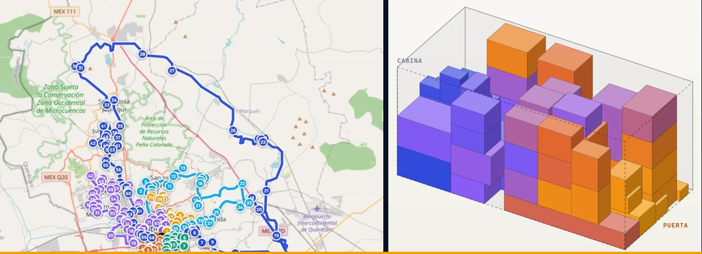
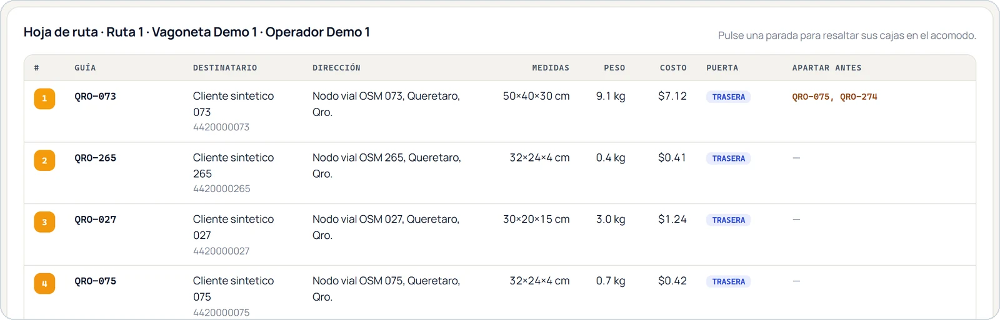

<p></p>

# Plan routes and loads together

Choose which vehicle handles each delivery, the order of its stops and where to place each box for unloading. The engine runs on your computer. The [Planner](https://lattimex.com/planner) displays the result in your browser.

**[See the Querétaro example](#from-orders-to-dispatch) · [Install the engine](#install-the-engine) · [Discuss an implementation](#implementation)**



*The Planner includes this example with 300 synthetic deliveries, six vans and five operators. Map © [OpenStreetMap contributors](https://www.openstreetmap.org/copyright).*

[Español](README.md) · English · [](https://github.com/Erick-MF28/lattimex/releases/latest)

## From orders to dispatch

1. **Load the orders and fleet.** Enter delivery locations, package dimensions and weights, and the capacity of each vehicle.
2. **Review routes and loads.** Select a vehicle on the map to see its stops, distance and cost. The 3D view shows which boxes sit by the door and which deliveries require moving other boxes.
3. **Give the driver the route sheet.** It lists the stops in order, the packages for each delivery and the unloading instructions.



<details>
<summary>See all example screens</summary>

[Route map](docs/img/planner-rutas.webp) · [Route detail](docs/img/planner-ruta-detalle.webp) · [3D loading](docs/img/planner-acomodo-3d.webp) · [Indicators](docs/img/planner-indicadores.webp) · [Fleet](docs/img/planner-flota.webp) · [Orders](docs/img/planner-guias.webp)

</details>

## What SENDA5 adds

The **upcoming 1.3.0 release** integrates SENDA5 into engine 1.9.0. Its corrected clock counts initial polishing against each run’s time budget.

In the CVRP routing benchmark with a calibrated four-second budget, **SENDA5 solved all 100 instances**. Its mean gap to the best known solutions was **0.549%**. Each instance ran once, on one thread with an unrestricted fleet. On the 98 instances solved by all seven tools, SENDA5’s mean gap was **0.534%**. The difference against AILS-II was not statistically significant. [Results, measured times and limitations](docs/en/SENDA5.md) · [Changelog](docs/en/CHANGELOG.md)

## Install the engine

Building this branch from source requires Python 3.10 or later and a C++ compiler. On Windows, use a short path such as `C:\lattimex`. If you need a compiler, install one with `python -m pip install ziglang`.

```bash
git clone --branch release-1.3.0 https://github.com/Erick-MF28/lattimex.git
cd lattimex
python -m pip install -r requirements.txt
python -m lattimex build
python -m lattimex map --bbox 20.47,-100.52,20.82,-100.22 --name queretaro
python -m lattimex serve
```

Leave the server running and open the [Planner](https://lattimex.com/planner). Allow access to the local device if your browser asks. Under **Guías** (orders), choose **Cargar ejemplo** (load example). Under **Planificación** (planning), choose **Optimizar** (optimize). When the plan is ready, select a van to inspect its stops and load.

<details>
<summary>Desktop launcher, data folder and diagnostics</summary>

After building, run `python -m lattimex app` to start the server and open the Planner from a desktop window. See [Windows packaging](packaging/windows/README.md). To use a separate data folder, start the server with `python -m lattimex serve --data D:\operations\client_a`. Check the installation with `python -m lattimex doctor` and the installed version with `python -m lattimex --version`.

</details>

<a id="implementation"></a>

## Implementation for your fleet

| Question | How it works |
|---|---|
| Where is our data stored? | Orders, fleet records and plans stay on the customer’s computer. The server listens on `127.0.0.1` and checks the origin and a session token for data requests. [Security](docs/en/SECURITY.md) |
| Can it work with our existing system? | A pilot can start with a CSV export from your ERP, WMS or TMS. A local program can request an optimization and retrieve the plan through the API. We check field mappings against a sample file. [Local API](docs/en/API_LOCAL.md) |
| Can it connect to our GPS platform? | To send stops to a GPS platform, we review its formats and permissions. For live tracking, we assess the development work and scope with the provider. |
| How do we get a quote? | The engine is MIT-licensed. To estimate installation, integration and training, tell us your number of depots, vehicles and deliveries on a typical day, and which systems you want to connect. |

**Implementation contact:** [contacto@lattimex.com](mailto:contacto@lattimex.com) · [lattimex.com](https://lattimex.com)

## Development and research

```text
Planner (browser)
  └─ Local server
       ├─ Road map and operational data
       └─ SENDA5 routing → P3L 3D loading → verification
```

In automatic mode the full engine uses SENDA 1.0 for fewer than six destinations per vehicle. In standalone CVRP, the SENDA5 selector starts with SENDA2 below 125 nodes. [Architecture](docs/en/ARCHITECTURE.md) · [Maps](docs/en/MAPS.md) · [Planner](docs/en/PLANNER.md)

| To | Resource |
|---|---|
| Run routing or packing independently | `python -m lattimex cvrp instance.vrp --time 4` · `python -m lattimex pack boxes.json`. The CLI allocates 80% of `--time` to the core. [Benchmark protocol](docs/en/SENDA5.md) |
| Review measurements and methods | [SENDA5 audit](docs/senda5_auditoria.json) · [Academic notes](docs/en/ACADEMIC_NOTES.md) · Historical guides to [SENDA](paper/senda_guide_en.pdf), [SENDA2](paper/senda2_guide_en.pdf) and [SENDA3](paper/guia_senda3.pdf) (last guide in Spanish) |
| Explore the code | [Native cores](native/) · [Engine](lattimex/engine/) · [Server](lattimex/server.py) · [Tests](tests/) |

<details>
<summary>Run the tests and get the engine fingerprint</summary>

```bash
python -m unittest discover -s tests/engine
python -m unittest tests.test_senda3 tests.test_senda5 tests.test_local_api -v
python tests/native/test_pack3d_equivalencia.py
python -m lattimex probe
```

</details>

## Licenses

- **Engine, local server and map builder:** [MIT](LICENSE). You may use, modify and distribute them,
  including commercially, keeping the copyright and license notices.
- **LATTIMEX Planner** (lattimex.com/planner): free to use; it is not distributed in this repository
  and may not be redistributed or commercially exploited by third parties. See
  [its license](https://lattimex.com/planner/licencia.html).
- **Educational guides** (`paper/`): [CC BY 4.0](https://creativecommons.org/licenses/by/4.0/). You may
  share and adapt it, including commercially, citing the source ([CITATION.cff](CITATION.cff)),
  linking the license and indicating the changes made.
- **Street data:** © OpenStreetMap contributors, [ODbL 1.0](https://opendatacommons.org/licenses/odbl/).
- **Trademark:** "LATTIMEX" and its logo are not covered by the MIT license. See [NOTICE](NOTICE).
- Dependencies: see [docs/en/THIRD_PARTY_LICENSES.md](docs/en/THIRD_PARTY_LICENSES.md). Code
  provenance: [docs/en/AUTHORSHIP.md](docs/en/AUTHORSHIP.md). Changes:
  [docs/en/CHANGELOG.md](docs/en/CHANGELOG.md).


## Donations

The LATTIMEX engine is free and open source. If the engine, the guide or the Planner are useful to
you, you can support their development with a donation: every contribution funds maintenance, new
cities and more educational material.

<p align="center"><a href="https://www.paypal.com/donate/?hosted_button_id=ZAAQQDBG2C4ZE"><b>♥ Donate to LATTIMEX with PayPal</b></a></p>

One-time, monthly or yearly donations, by card or PayPal account.

Would your company like to sponsor a feature or an integration? Write to contacto@lattimex.com.
