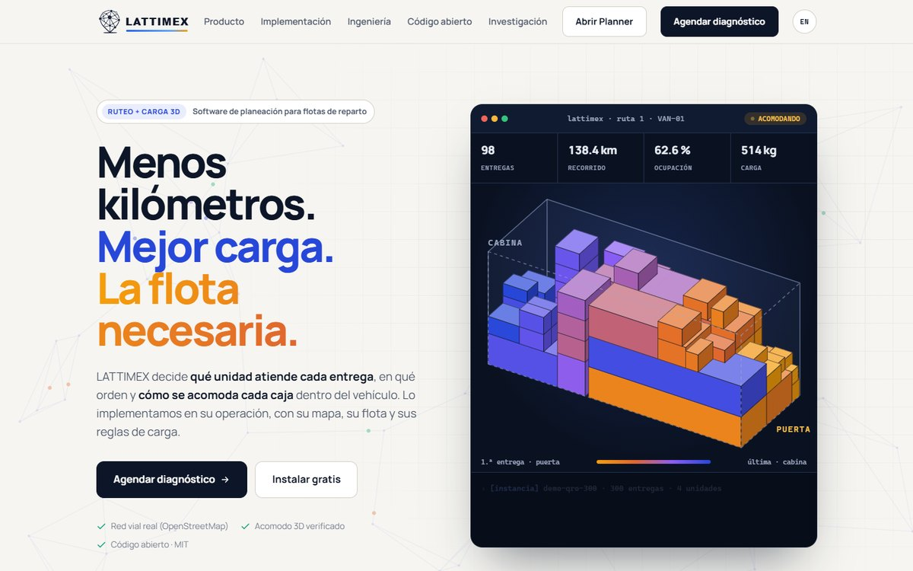
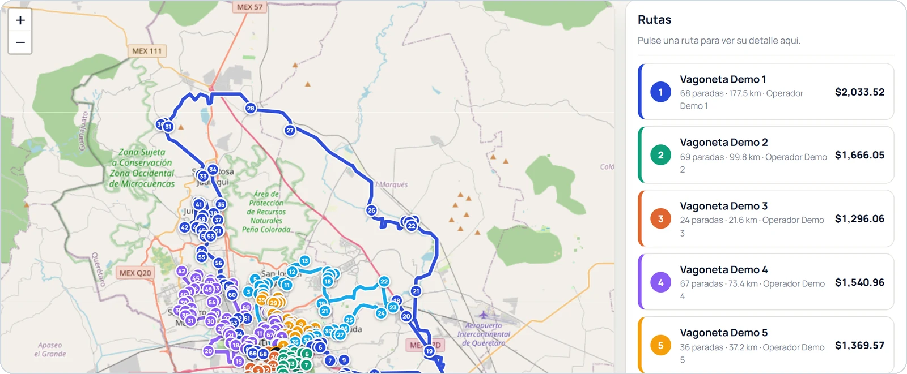
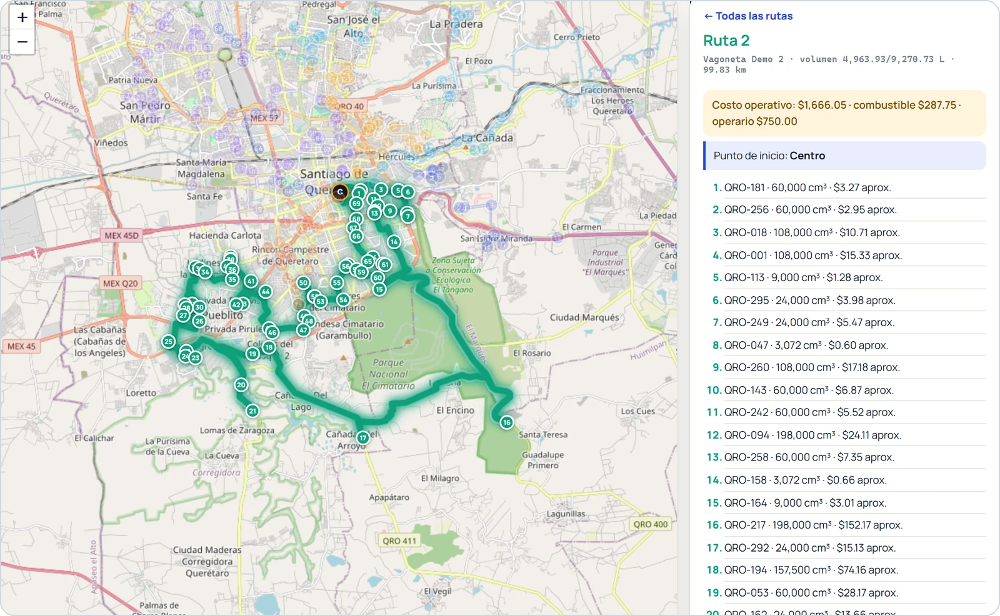
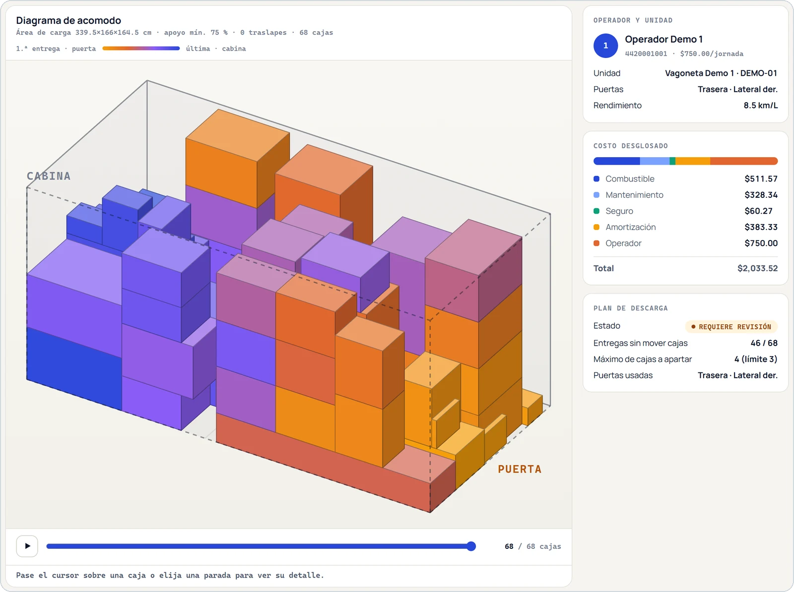
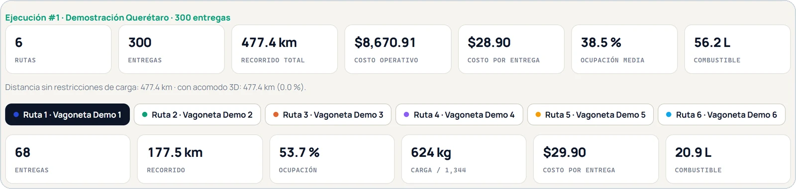
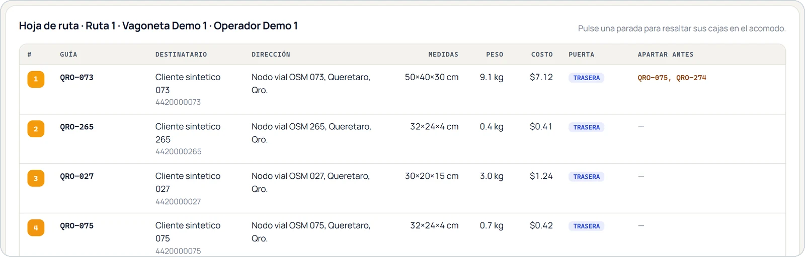
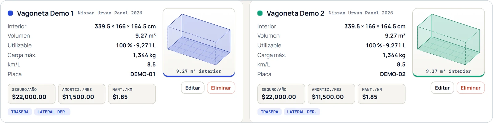
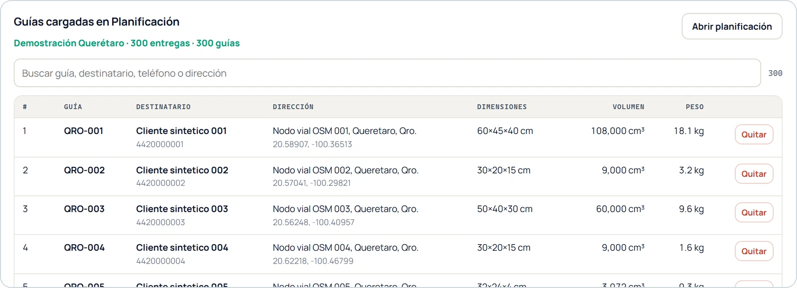

# LATTIMEX

**Ruteo de vehículos con acomodo 3D de carga, en su propia computadora.**

Español · [English](README.en.md)

[](https://github.com/Erick-MF28/lattimex/releases/latest)
[](LICENSE)
[](https://lattimex.com)
[](https://lattimex.com/planner)

LATTIMEX decide qué unidad atiende cada entrega, en qué orden, y cómo se acomoda cada caja dentro
del vehículo, sobre la red vial real de su ciudad. Este repositorio contiene el **motor de
optimización**, el **servidor local** y el **generador de mapas**. La interfaz gráfica es el
[LATTIMEX Planner](https://lattimex.com/planner), que se abre en el navegador y trabaja con el motor
que usted ejecuta: **sus datos nunca salen de su computadora**.

[](https://lattimex.com)

<p align="center"><a href="https://lattimex.com"><b>Conozca LATTIMEX en lattimex.com →</b></a></p>

> **Versión 1.3.0** (motor `lattimex-engine-1.9.0`): **SENDA5 con reloj corregido**.
> A cuatro segundos de pared calibrada, una corrida por instancia X, su brecha media es **0.534 %**
> sobre las 98 instancias resueltas por las siete herramientas (BKS actuales de CVRPLIB, 17-nov-2026).
> Tiene menor brecha que FILO2, HGS, PyVRP y OR-Tools; **sin diferencia significativa frente a
> AILS-II**. Sobre sus 100 soluciones la brecha es 0.549 %. Es evidencia de CVRP, no de acomodo 3D.
> Bajo 125 nodos conserva SENDA2. Se mantienen P3L y el flujo del Planner.
> [Resultados auditados y límites](docs/SENDA5.md) · [Registro de cambios](CHANGELOG.md).
> Para consultar su versión instalada: `python -m lattimex --version`.

## Pruébelo en cinco minutos

Requisitos: Python 3.10 o superior y un compilador de C++ (g++ o clang++). En Windows, si no tiene
compilador, `pip install ziglang` instala uno portátil que LATTIMEX usa automáticamente (clone en
una ruta corta, por ejemplo `C:\lattimex`: `ziglang` falla con rutas de más de 260 caracteres).

```bash
git clone https://github.com/Erick-MF28/lattimex.git
cd lattimex
pip install -r requirements.txt        # en Windows sin compilador: pip install ziglang
python -m lattimex build               # compila el motor y el empacador 3D
python -m lattimex map --bbox 20.47,-100.52,20.82,-100.22 --name queretaro
python -m lattimex serve               # http://127.0.0.1:8765
```

Abra **https://lattimex.com/planner** en Chrome, Edge o Firefox. La primera vez el navegador pedirá
permiso para acceder a servicios de este dispositivo: acéptelo. En **Guías**, el botón
**Cargar ejemplo** agrega 300 entregas sintéticas en Querétaro, seis vagonetas y cinco operarios; en
**Planificación**, un solo botón, **Optimizar**, calcula las rutas y el acomodo de cada caja.

**Sus datos se quedan donde usted decida.** Flota, guías, instancias y ejecuciones se guardan en
`data/lattimex.sqlite3`; si cierra el Planner, al volver encuentra su última operación, y las guías
capturadas que aún no guardó se recuperan solas. Para trabajar con otra carpeta (por ejemplo, una
por cliente o una compartida en red):

```bash
python -m lattimex serve --data D:\operaciones\cliente_a
```

`python -m lattimex doctor` revisa la instalación; `python -m lattimex probe` imprime la huella
del motor. Las huellas de 1.3.0 y las referencias históricas están en
[Autoría](AUTHORSHIP.md). Dependen de la biblioteca estándar de C++ utilizada al compilar.

## Tres formas de usar el motor

Desde la versión 1.1.0 cada pieza se puede probar por separado:

```bash
python -m lattimex cvrp X-n1001-k43.vrp --time 4    # SENDA5 solo, CVRP clásico (archivos de CVRPLIB)
python -m lattimex pack cajas.json                  # el acomodador 3D solo, para una ruta
python -m lattimex serve                            # el motor completo, para el Planner
```

- **SENDA5 solo** elige el algoritmo por tamaño y verifica cobertura, capacidad y costo.
  `--router senda3`, `--router senda2` y `--router senda` eligen los núcleos históricos en la CLI.
  La CLI asigna al núcleo el 80 % de `--time`; el [experimento de cuatro segundos](docs/SENDA5.md)
  usa un protocolo de reloj calibrado aparte.
- **El acomodador solo** (P3L) recibe un JSON con el contenedor y las cajas (`stop` = orden de
  entrega) y devuelve la posición de cada caja y si el acomodo cumple soporte, fragilidad y orden de
  descarga.
- **El motor completo** rutea con SENDA5, acomoda con P3L respetando el orden de descarga y, si una
  ruta no cabe así, lo dice en la respuesta (`lifo_estricto`, `advertencias`). Con
  `"fleet_mode": "up_to"` puede usar menos unidades de las disponibles.

**¿Prefiere no usar la terminal?** `python -m lattimex app` abre una ventana que arranca el motor,
prepara el mapa de su ciudad y abre el Planner. La misma ventana se empaqueta como aplicación de
Windows con instalador, sin requisitos previos: ver [packaging/windows](packaging/windows/README.md).

## Así se ve

Capturas del Planner con el ejemplo incluido: 300 entregas en Querétaro, seis vagonetas y cinco
operarios.

**Rutas sobre calles reales.** Una ruta por color sobre el mapa de
[OpenStreetMap](https://www.openstreetmap.org/copyright) y, a la derecha, cada unidad con sus paradas,
kilómetros, operario y costo.



**Una ruta a la vez.** Al elegir una ruta, el mapa la encuadra y el panel muestra su costo
desglosado y la secuencia de paradas.



**Acomodo 3D de la carga.** Cada caja dentro de la unidad, de la cabina a la puerta en orden inverso
de entrega, junto con el operario, el costo desglosado y el plan de descarga.



**Indicadores de la ejecución y de cada ruta.**



**Hoja de ruta para el operario**, con medidas, peso, costo por entrega, puerta de descarga y qué
cajas apartar antes.



**Flota y guías.** Medidas interiores, puertas, carga máxima y costos de cada unidad; guías capturadas
a mano, desde CSV o con el ejemplo.





Datos cartográficos de las capturas: © [colaboradores de OpenStreetMap](https://www.openstreetmap.org/copyright),
disponibles bajo ODbL 1.0.

## Cómo funciona

```text
 lattimex.com/planner  ──(solo interfaz)──►  navegador
                                                │  http://127.0.0.1:8765
                                                ▼
                         ┌──────────── su computadora ────────────┐
                         │  servidor local  →  SENDA2 (C++)        │
                         │  base SQLite     →  acomodador P3L (C++)│
                         │  mapa propio     →  verificador          │
                         └─────────────────────────────────────────┘
```

1. **Mapa propio.** `python -m lattimex map` construye, una sola vez, el grafo vial de su ciudad a
   partir de OpenStreetMap. Distancias y rutas se calculan sobre calles reales, sin servicios externos.
2. **Ruteo.** El núcleo de ruteo, SENDA2, es SENDA (*Single-trajectory ENgine with Destroy-and-repair
   Adaptive search*) con una reparación con caché y un tope de pulido: sigue una sola trayectoria de
   búsqueda por corrida, sin población ni cruce, construye rutas, las mejora con búsqueda local granular
   y las reestructura con una búsqueda adaptativa de vecindarios grandes (ALNS), en un portafolio de
   corridas en paralelo. Con pocas entregas por unidad usa el núcleo SENDA de la versión 1.0.0.
3. **Carga 3D.** El acomodador P3L coloca cada caja respetando soporte, fragilidad y orden de
   descarga, y un verificador estricto revisa cada acomodo; si algo no cabe, un mediador reajusta las
   rutas con la flota fija y, como último recurso, relaja el orden de descarga de esa ruta y lo informa.
4. **Verificación.** Un verificador independiente revalida distancias, capacidad, cobertura y la
   geometría de cada caja antes de entregar el plan.

Detalles en [docs/ARCHITECTURE.md](docs/ARCHITECTURE.md), [docs/MAPS.md](docs/MAPS.md) y
[docs/SECURITY.md](docs/SECURITY.md).

## Aprenda cómo funciona el motor

La guía educativa [**paper/guia_senda.pdf**](paper/guia_senda.pdf) explica desde
cero, con ejemplos resueltos, cada componente de SENDA, su complejidad computacional, cómo se evaluó frente a solvers de
referencia de la literatura y qué errores de evaluación conviene evitar. Termina con una sección para
repetir las mediciones en su computadora. Versión en inglés:
[paper/senda_guide_en.pdf](paper/senda_guide_en.pdf).

La segunda guía, [**paper/guia_senda2.pdf**](paper/guia_senda2.pdf) (versión 1.1.0), cuenta el avance
con la misma línea: SENDA2 frente a HGS-CVRP y FILO2, cómo se midió un acomodador contra los óptimos
publicados de Tamke et al. (2026), qué defectos de la versión 1.0.0 destapó esa medición y cómo se
integraron ruteo y acomodo. Versión en inglés: [paper/senda2_guide_en.pdf](paper/senda2_guide_en.pdf). Los programas usados para comparar no forman parte de este
repositorio; las notas y referencias están en [docs/ACADEMIC_NOTES.md](docs/ACADEMIC_NOTES.md).

La tercera guía, [**paper/guia_senda3.pdf**](paper/guia_senda3.pdf) (versión 1.2.0), explica por qué SENDA2
no escalaba, cómo funciona el bucle de SENDA3 y por qué el motor elige el algoritmo según el tamaño, y lo
mide contra SENDA2, HGS-CVRP y FILO2 con presupuestos de segundos, incluido lo que no le favorece.

## Qué hay en este repositorio

| Carpeta | Contenido |
|---|---|
| `native/` | SENDA5 (`senda5_core.cpp`, por omisión), SENDA3 (1.2.0), SENDA2 (1.1.0) y SENDA (1.0.0); acomodadores P3L (`p3l.cpp`, por omisión) y de puntos extremos (`pack3d.cpp`) |
| `lattimex/engine/` | Tubería del motor: capacidad efectiva, empaque 3D y verificador estricto, mediación con flota fija, R3L (flota "hasta k" en instancias pequeñas), plan de descarga por puertas |
| `lattimex/cvrp.py` | SENDA5 solo (o núcleos anteriores) sobre archivos de CVRPLIB (`python -m lattimex cvrp`) |
| `lattimex/server.py` | Servidor local para el Planner (solo escucha en 127.0.0.1) |
| `lattimex/maps.py` | Construcción del mapa propio desde OpenStreetMap |
| `tests/` | Pruebas del motor, equivalencia C++/Python del empacador y pruebas del servidor |
| `paper/` | Guías educativas 1 (SENDA, 1.0.0) y 2 (SENDA2 y carga 3D, 1.1.0), en español y en inglés, y 3 (SENDA3, 1.2.0), en español (LaTeX y PDF) |
| `packaging/windows/` | Aplicación e instalador de Windows (ventana de inicio sin terminal) |
| `docs/` | Arquitectura, conexión con el Planner, seguridad, mapas, API local y notas académicas (`docs/en/` en inglés) |

## Pruebas

```bash
python -m unittest discover -s tests/engine        # pruebas del motor, del acomodador y de `cvrp`/`pack`
python -m unittest tests.test_local_api -v         # recorrido completo y defensas del servidor
python tests/native/test_pack3d_equivalencia.py    # 72 casos: C++ idéntico a Python (tarda ~10 min)
python -m lattimex probe                           # huella determinista del motor
```

## Licencias

- **Motor, servidor local y generador de mapas:** [MIT](LICENSE). Puede usarlos, modificarlos y
  distribuirlos, también con fines comerciales, conservando los avisos de copyright y licencia.
- **LATTIMEX Planner** (lattimex.com/planner): uso gratuito; no se distribuye en este repositorio y
  no puede redistribuirse ni explotarse comercialmente por terceros. Ver
  [su licencia](https://lattimex.com/planner/licencia.html).
- **Guías educativas** (`paper/`): [CC BY 4.0](https://creativecommons.org/licenses/by/4.0/deed.es).
  Puede compartirla y adaptarla, incluso comercialmente, citando la fuente ([CITATION.cff](CITATION.cff)),
  enlazando la licencia e indicando los cambios realizados.
- **Datos de calles:** © colaboradores de OpenStreetMap, [ODbL 1.0](https://opendatacommons.org/licenses/odbl/).
- **Marca:** "LATTIMEX" y su logotipo no están cubiertos por la licencia MIT. Ver [NOTICE](NOTICE).
- Dependencias: ver [THIRD_PARTY_LICENSES.md](THIRD_PARTY_LICENSES.md). Procedencia del código:
  [AUTHORSHIP.md](AUTHORSHIP.md).

## Implementación

El motor se ofrece sin costo bajo MIT. Los servicios de implementación, configuración, integración
y capacitación se cotizan por separado.

¿Prefiere que lo instalemos e integremos con su operación (mapa, flota, reglas de carga, ERP/WMS/TMS,
capacitación)? Visite [lattimex.com](https://lattimex.com) o escriba a **contacto@lattimex.com**.

## English

The full English version of this page is [README.en.md](README.en.md); the documentation is in
[docs/en/](docs/en/) and the educational guides in [paper/senda_guide_en.pdf](paper/senda_guide_en.pdf) and
[paper/senda2_guide_en.pdf](paper/senda2_guide_en.pdf).

## Donaciones

El motor LATTIMEX es gratuito y de código abierto. Si el motor, la guía o el Planner le son útiles, puede
apoyar su desarrollo con una donación: cada aporte financia mantenimiento, nuevas ciudades y más
material educativo.

<p align="center"><a href="https://www.paypal.com/donate/?hosted_button_id=ZAAQQDBG2C4ZE"><b>♥ Donar a LATTIMEX con PayPal</b></a></p>

Acepta donaciones únicas, mensuales o anuales, con tarjeta o con cuenta de PayPal.

¿Su empresa quiere patrocinar una función o una integración? Escriba a contacto@lattimex.com.
