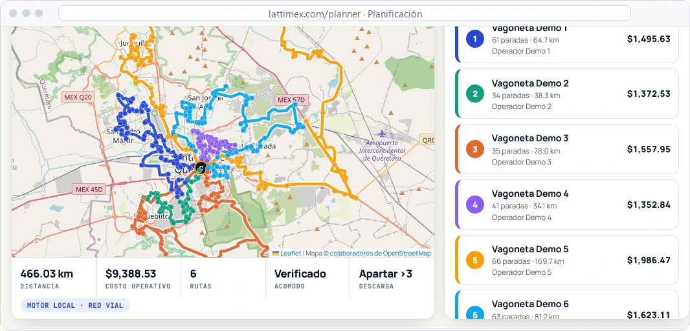
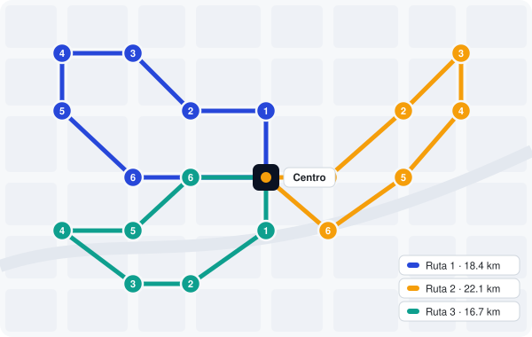
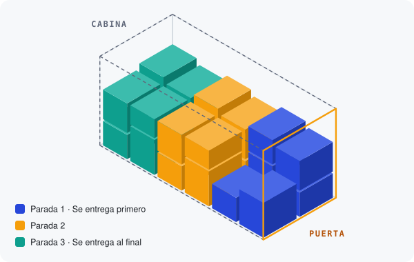
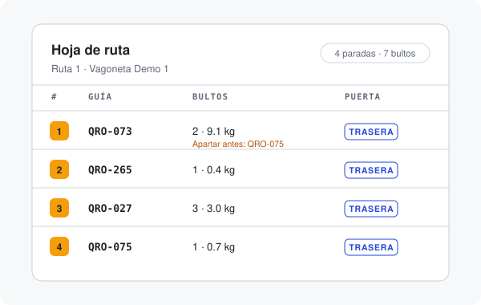
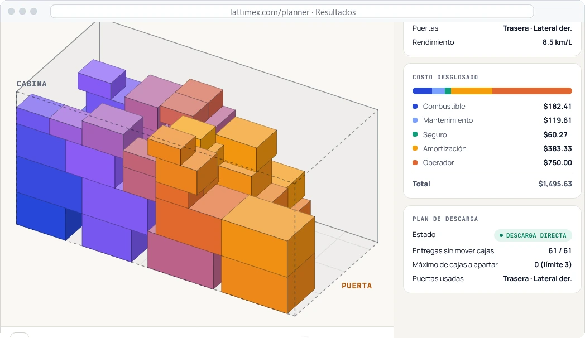
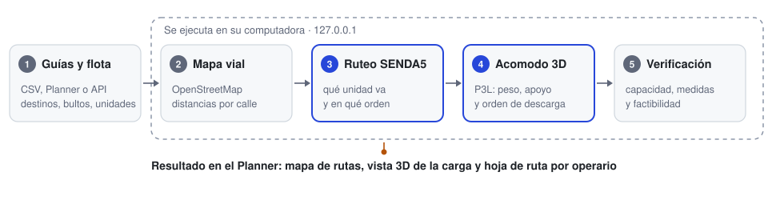
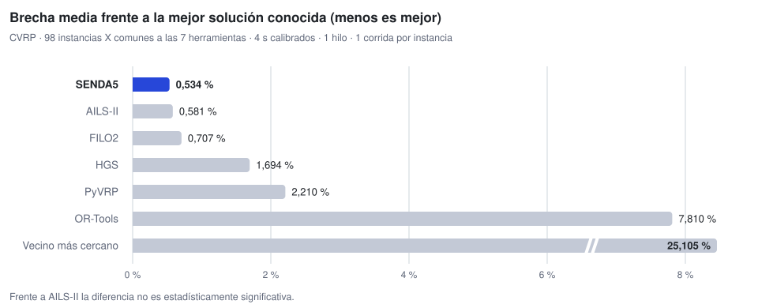

<div align="center">


### Rutas y acomodo de carga en un solo plan, calculados en su propia computadora

Decida qué unidad atiende cada entrega, en qué orden recorre las paradas<br>
y cómo acomodar las cajas para descargarlas sin mover las demás.

[](CHANGELOG.md)
[](docs/SENDA5.md)
[](https://github.com/Erick-MF28/lattimex/actions/workflows/ci.yml)
[](LICENSE)
[](pyproject.toml)
[](native/)

[**Probar en 10 minutos**](#probar-en-10-minutos) · [Cómo funciona](#cómo-funciona) · [Resultados de SENDA5](#senda5-el-núcleo-de-ruteo) · [Implementación](#implementación-en-su-operación) · [English](README.en.md)

</div>

<br>

<p align="center"></p>

<p align="center"><sub>Ejemplo incluido en el Planner: 300 entregas sintéticas y seis vagonetas en Querétaro, optimizadas con el motor 1.9.0 (466 km, acomodo verificado). Mapa © <a href="https://www.openstreetmap.org/copyright">colaboradores de OpenStreetMap</a>.</sub></p>

## ¿Para quién es?

<table>
<tr>
<td width="32%">🚚 &nbsp;<b>Planeadores de flotilla</b></td>
<td>Arman las rutas del día sin hojas de cálculo. Ven en el mapa qué recorre cada unidad y en 3D cómo va la carga.</td>
</tr>
<tr>
<td width="32%">📦 &nbsp;<b>Dueños y directores de reparto</b></td>
<td>Comparan kilómetros, costo y unidades necesarias antes de despachar. Los datos de la operación no salen de su equipo.</td>
</tr>
<tr>
<td width="32%">🧑‍💻 &nbsp;<b>Desarrolladores e investigadores</b></td>
<td>Disponen de un motor MIT con núcleos en C++, una API local, pruebas reproducibles y mediciones auditadas contra solucionadores de referencia.</td>
</tr>
</table>

## Qué resuelve en un día de reparto

<table>
<tr>
<td width="33%" valign="top">
<picture>
<source media="(prefers-color-scheme: dark)" srcset="docs/img/readme/ilus-rutas-oscuro.svg">

</picture>
<p><b>1 · Quién va y por dónde</b><br>
Asigna las entregas a las unidades y ordena las paradas sobre las calles reales. Cada ruta muestra sus paradas, sus kilómetros y su costo.</p>
</td>
<td width="33%" valign="top">
<picture>
<source media="(prefers-color-scheme: dark)" srcset="docs/img/readme/ilus-carga-oscuro.svg">

</picture>
<p><b>2 · Cómo va la carga</b><br>
Acomoda cada caja según sus medidas, su peso y su apoyo. Lo que se entrega primero queda junto a la puerta.</p>
</td>
<td width="33%" valign="top">
<picture>
<source media="(prefers-color-scheme: dark)" srcset="docs/img/readme/ilus-hoja-oscuro.svg">

</picture>
<p><b>3 · Qué recibe el operario</b><br>
Una hoja de ruta con las paradas en orden, los bultos de cada entrega y las indicaciones de descarga.</p>
</td>
</tr>
</table>

## Probar en 10 minutos

**Requisitos:** Python 3.10 o superior y un compilador de C++. Si no tiene compilador, instale uno con `python -m pip install ziglang`. En Windows, clone el repositorio en una ruta corta, como `C:\lattimex`.

**1. Descargue el código e instale las dependencias**

```bash
git clone https://github.com/Erick-MF28/lattimex.git
cd lattimex
python -m pip install -r requirements.txt
```

**2. Compile el motor.** Este paso genera las bibliotecas nativas de ruteo y de acomodo.

```bash
python -m lattimex build
```

**3. Construya el mapa vial.** El ejemplo descarga Querétaro de OpenStreetMap. Para otra ciudad, cambie el recuadro `sur,oeste,norte,este` y el nombre.

```bash
python -m lattimex map --bbox 20.47,-100.52,20.82,-100.22 --name queretaro
```

**4. Inicie el servidor local y abra el Planner**

```bash
python -m lattimex serve
```

Deje el servidor en ejecución y abra **[lattimex.com/planner](https://lattimex.com/planner)**. Permita la conexión con el dispositivo si el navegador la solicita. El Planner trabaja con el servidor de su computadora en `127.0.0.1`.

**5. Optimice el ejemplo.** En **Guías**, pulse **Cargar ejemplo**. En **Planificación**, pulse **Optimizar**. Al terminar, seleccione una vagoneta para revisar sus paradas y el acomodo de su carga.

<p align="center"></p>
<p align="center"><sub>Resultados de la vagoneta Demo 1: sus 61 entregas se descargan sin mover otras cajas.</sub></p>

> [!TIP]
> Compruebe la instalación con `python -m lattimex doctor`. Para trabajar sin terminal, use `python -m lattimex app`: inicia el servidor y abre el Planner desde una ventana. Para separar los datos de cada operación, arranque con `python -m lattimex serve --data D:\operaciones\cliente_a`. En Windows, consulte el [empaquetado](packaging/windows/README.md).

## Cómo funciona

<picture>
  <source media="(prefers-color-scheme: dark)" srcset="docs/img/readme/flujo-oscuro.svg">
  
</picture>

El servidor local solo escucha en `127.0.0.1` y exige un token de sesión. Las guías, la flota y los planes se quedan en su equipo ([seguridad](docs/SECURITY.md)). El motor resuelve juntos el ruteo y el acomodo. Si las cajas de una ruta no caben respetando el orden de descarga, el plan lo advierte y marca la ruta.

| Pieza | Qué hace | Dónde está |
|---|---|---|
| **SENDA5** | Ruteo de vehículos con capacidad (CVRP). Con menos de 125 nodos usa SENDA2. | [`native/senda5_core.cpp`](native/senda5_core.cpp) |
| **P3L** | Acomodo 3D con peso, apoyo, fragilidad y orden de descarga por puerta. | [`native/p3l.cpp`](native/p3l.cpp) |
| **Motor** | Combina ruteo, acomodo y verificación. Con menos de seis destinos por unidad usa SENDA 1.0. | [`lattimex/engine/`](lattimex/engine/) |
| **Servidor y mapas** | API local, base de datos SQLite y red vial generada desde OpenStreetMap. | [`lattimex/server.py`](lattimex/server.py) · [mapas](docs/MAPS.md) |

Más detalle en [Arquitectura](docs/ARCHITECTURE.md) y [Planner](docs/PLANNER.md).

## SENDA5: el núcleo de ruteo

La versión 1.3.0 integra SENDA5 en el motor `lattimex-engine-1.9.0`. Lo comparamos con seis herramientas en 100 instancias X de CVRPLIB, de 100 a 1,000 clientes, con el mismo reloj para todas.

<picture>
  <source media="(prefers-color-scheme: dark)" srcset="docs/img/readme/senda5-brecha-oscuro.svg">
  
</picture>

- **SENDA5 resolvió las 100 instancias** con una brecha media de **0,549 %**. El 0,534 % de la gráfica corresponde a las 98 instancias que resolvieron las siete herramientas.
- La ventaja frente a FILO2, HGS, PyVRP y OR-Tools es estadísticamente significativa (IC95 bootstrap). **Frente a AILS-II no lo es:** SENDA5 obtuvo menor brecha en 54 instancias, empató en 3 y quedó detrás en 43.
- **Límites:** hubo una corrida por instancia, con un hilo, flota libre y un presupuesto calibrado de 4 s. El algoritmo se desarrolló sobre estas mismas instancias. Los resultados no demuestran mejoras con ventanas de tiempo, flota fija ni acomodo 3D.

📊 [Resultados completos, tiempos medidos y límites](docs/SENDA5.md) · [Resumen de la auditoría (JSON)](docs/senda5_auditoria.json) · [Cambios de la versión](CHANGELOG.md)

## Úselo a su manera

| Si quiere… | Use | Más información |
|---|---|---|
| Planear la operación diaria con mapa y vista 3D | El **Planner** con el servidor local | [Planner](docs/PLANNER.md) |
| Conectar su ERP, WMS o TMS | La **API local**: recibe guías y flota y devuelve rutas y acomodo | [API local](docs/API_LOCAL.md) |
| Resolver solo el ruteo de un archivo de CVRPLIB | `python -m lattimex cvrp instancia.vrp --time 4` | [Protocolo](docs/SENDA5.md#uso-e-integración) |
| Acomodar solo las cajas de una ruta | `python -m lattimex pack cajas.json` | [Arquitectura](docs/ARCHITECTURE.md) |
| Generar entregas sintéticas para probar | `python -m lattimex sample --n 300` | |

<details>
<summary><b>Ejemplo de solicitud a la API local</b></summary>
<br>

`POST /api/engine/v1/solve` crea un trabajo de optimización. El punto 0 es el centro de distribución. La respuesta incluye la secuencia de cada ruta, la posición de cada caja y el plan de descarga.

```json
{
  "points": [{"lat": 20.5888, "lng": -100.3899}, {"lat": 20.5879, "lng": -100.3819}],
  "fleet": [{"cargo_cm": [365, 139, 165], "max_weight_kg": 1900, "doors": ["rear"]}],
  "fleet_count": 1,
  "packages": [{"id": "QRO-181", "node": 1, "dims_cm": [45, 35, 25], "weight_kg": 6.2}],
  "constraints": {"support": true, "fragility": false, "lifo": false},
  "budget_sec": 10
}
```

Todas las rutas `/api/*` piden el token de sesión que entrega `GET /api/runtime`. Consulte la [referencia completa](docs/API_LOCAL.md).

</details>

## Implementación en su operación

| Pregunta | Respuesta |
|---|---|
| **¿Dónde quedan los datos?** | En el equipo del cliente. El servidor solo acepta conexiones locales y comprueba el origen y el token de cada solicitud. [Seguridad](docs/SECURITY.md) |
| **¿Cómo se conecta con nuestro sistema?** | El piloto puede empezar con un CSV exportado del ERP, WMS o TMS. Para una conexión automática se usa la [API local](docs/API_LOCAL.md). Validamos los campos con un archivo de ejemplo. |
| **¿Se puede vincular con nuestro GPS?** | Para enviar paradas a una plataforma GPS revisamos sus formatos y permisos. El seguimiento en tiempo real se evalúa con el proveedor. |
| **¿Cómo se cotiza?** | El motor es MIT y gratuito. Para estimar la instalación, la integración y la capacitación, indíquenos sus centros de salida, sus unidades, las entregas de un día típico y los sistemas que desea conectar. |

<p align="center">
<a href="mailto:contacto@lattimex.com"><b>✉ contacto@lattimex.com</b></a> &nbsp;·&nbsp; <a href="https://lattimex.com"><b>lattimex.com</b></a>
</p>

## Desarrollo e investigación

```bash
python -m unittest discover -s tests/engine                                    # motor completo
python -m unittest tests.test_senda3 tests.test_senda5 tests.test_local_api -v  # núcleos y API
python tests/native/test_pack3d_equivalencia.py                                # acomodo 3D
python -m lattimex probe                                                       # huella determinista
```

- **Métodos y bibliografía:** [notas académicas](docs/ACADEMIC_NOTES.md) y guías educativas de [SENDA](paper/guia_senda.pdf), [SENDA2](paper/guia_senda2.pdf) y [SENDA3](paper/guia_senda3.pdf).
- **Código:** [núcleos nativos](native/) · [motor](lattimex/engine/) · [servidor](lattimex/server.py) · [pruebas](tests/) · [procedencia del código](AUTHORSHIP.md).
- **Citar:** use [CITATION.cff](CITATION.cff) o el botón *Cite this repository* de GitHub.

## Licencias

| Componente | Licencia |
|---|---|
| Motor, servidor local y generador de mapas | [MIT](LICENSE). Permite usarlos, modificarlos y distribuirlos, también con fines comerciales, si se conservan los avisos. |
| LATTIMEX Planner (lattimex.com/planner) | Uso gratuito. No se distribuye en este repositorio. Terceros no pueden redistribuirlo ni explotarlo comercialmente. [Licencia](https://lattimex.com/planner/licencia.html) |
| Guías educativas (`paper/`) | [CC BY 4.0](https://creativecommons.org/licenses/by/4.0/deed.es). Se deben citar la fuente e indicar los cambios. |
| Datos de calles | © colaboradores de OpenStreetMap, [ODbL 1.0](https://opendatacommons.org/licenses/odbl/) |
| Marca «LATTIMEX» y logotipo | La licencia MIT no los cubre. Ver [NOTICE](NOTICE). |

Dependencias de terceros: [THIRD_PARTY_LICENSES.md](THIRD_PARTY_LICENSES.md).

## Apoye el proyecto

El motor es gratuito y de código abierto. Si el motor, las guías o el Planner le resultan útiles, su donación financia el mantenimiento, nuevas ciudades y más material educativo. Para patrocinar una función o una integración, escriba a contacto@lattimex.com.

<p align="center">
<a href="https://www.paypal.com/donate/?hosted_button_id=ZAAQQDBG2C4ZE"></a>
<br><sub>Donaciones únicas, mensuales o anuales, con tarjeta o cuenta de PayPal.</sub>
</p>

<p align="center"><sub>Hecho en Querétaro, México · <a href="https://lattimex.com">lattimex.com</a></sub></p>
